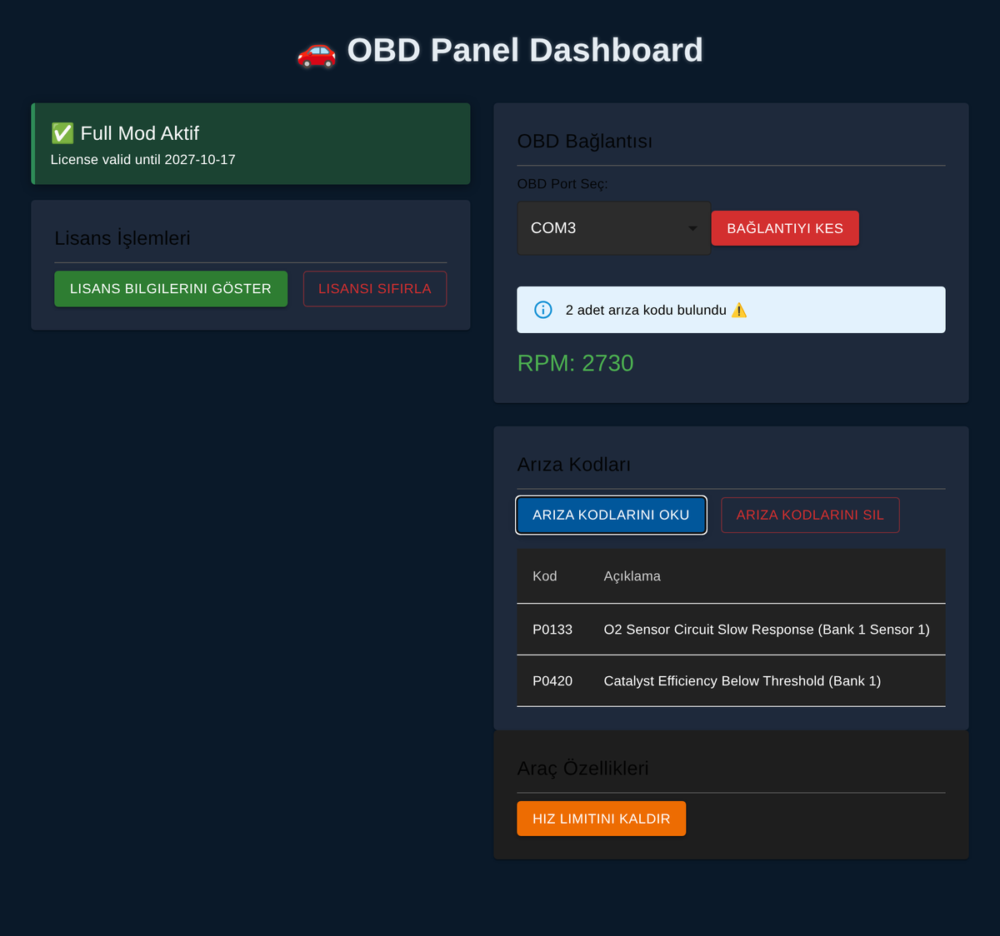
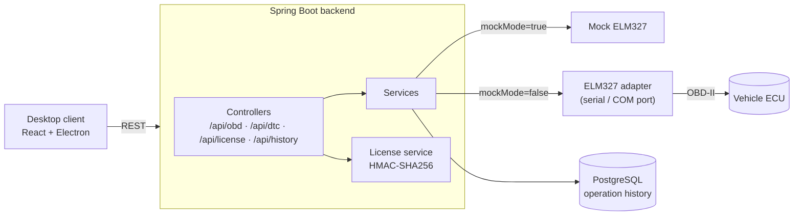

# 🚗 OBD Car Diagnostics — Backend

A Spring Boot backend that talks to a vehicle over **OBD-II** through an **ELM327** adapter on a serial port. It reads live engine data (RPM, VIN), reads and clears **diagnostic trouble codes (DTC)**, keeps an operation history, and protects the app with a **signed license system**.

Paired with the desktop client: **[car-project-frontend](https://github.com/Lutfu9907/car-project-frontend)** (React + Electron).



## ✨ Features
- **Serial communication with the vehicle** via jSerialComm and an ELM327 adapter (AT commands + OBD-II PIDs)
- **Live engine data** — RPM (`010C`) and VIN (`0902`)
- **Diagnostic trouble codes** — read stored DTCs (Mode `03`), clear them (Mode `04`), with human-readable descriptions
- **Mock mode** — switch between a real device and a simulated one with a single property, so the app can be developed and demoed without a car
- **License system** — license file signed with **HMAC-SHA256**, expiry date, validated on startup; the app runs in limited mode without a valid license
- **Operation history** — every action (connect, DTC read, etc.) is logged to PostgreSQL with VIN, result and timestamp

## 🏗️ Architecture



## 🔌 API

| Method | Endpoint | Description |
|---|---|---|
| GET | `/api/obd/ports` | List available serial ports |
| POST | `/api/obd/connect` | Open connection to the ELM327 adapter |
| POST | `/api/obd/disconnect` | Close the connection |
| GET | `/api/obd/rpm` | Read engine RPM |
| GET | `/api/obd/vin` | Read vehicle VIN |
| GET | `/api/dtc/read` | Read stored trouble codes |
| POST | `/api/dtc/clear` | Clear trouble codes |
| POST | `/api/license/activate` | Activate a license |
| GET | `/api/license/status` | License status |
| GET | `/api/license/details` | License details |
| DELETE | `/api/license/reset` | Remove the local license |
| GET | `/api/history` | Operation history |

## 🛠️ Tech Stack
Java · Spring Boot · Spring Data JPA · Spring Security · PostgreSQL · jSerialComm · Lombok · Maven

## 🚀 Getting Started

```bash
cd car-project-backend
./mvnw spring-boot:run
```

Key settings in `src/main/resources/application.properties`:

```properties
app.mockMode=true            # true = simulated device, false = real ELM327
obd.serial.portName=COM3
obd.serial.baudRate=38400
spring.datasource.url=jdbc:postgresql://localhost:5432/postgres
```

## 🗺️ Roadmap
- Real VAG coding features (CarPlay activation, video in motion) — currently available in mock mode only
- More live PIDs (speed, coolant temperature, fuel trim)
